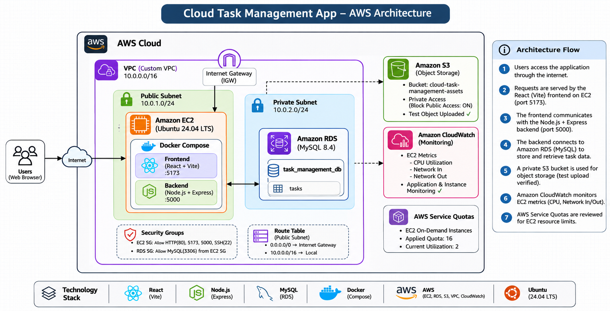

# Cloud Task Management App

### Full-Stack Application Deployment on AWS

A full-stack task management application deployed on Amazon Web Services (AWS). This project demonstrates practical implementation of AWS cloud services, application containerization, managed database integration, virtual networking, object storage, and cloud resource monitoring.

**Live Application:** [http://44.247.241.123:5173](http://44.247.241.123:5173)

**GitHub Repository:** [cloud-task-management-app](https://github.com/tahsinulhoque/cloud-task-management-app)

---

## 1. Project Overview

The goal of this project was to build and deploy a task management web application using a full-stack architecture and AWS cloud infrastructure.

The application uses React and Vite for the frontend, Node.js and Express.js for the backend, and Amazon RDS MySQL for persistent database storage.

The application services are containerized using Docker Compose and deployed on an Ubuntu-based Amazon EC2 instance.

Additional AWS services were configured to support networking, object storage, monitoring, and resource quota verification.

### Key Implementations

- Deployed a full-stack application on Amazon EC2.
- Containerized frontend and backend services using Docker Compose.
- Connected the backend application to Amazon RDS MySQL.
- Configured a custom AWS VPC with public and private subnets.
- Created a private Amazon S3 bucket and verified object upload.
- Monitored EC2 metrics using Amazon CloudWatch.
- Reviewed EC2 resource limits through AWS Service Quotas.
- Verified application logs using Docker Compose.

---

## 2. AWS Architecture

The following diagram represents the implemented application deployment and AWS infrastructure.



### Architecture Flow

1. Users access the application through a web browser.
2. The React + Vite frontend is hosted on Amazon EC2.
3. The frontend communicates with the Node.js + Express backend through the configured API proxy.
4. The backend connects to Amazon RDS MySQL for task data storage and retrieval.
5. Amazon S3 is configured as private object storage, with a test object successfully uploaded.
6. Amazon CloudWatch is used to monitor EC2 CPU utilization and network metrics.
7. AWS Service Quotas is used to review EC2 resource quota information.

---

## 3. Technology Stack

| Category | Technologies |
|---|---|
| Frontend | React, Vite |
| Backend | Node.js, Express.js |
| Database | MySQL, Amazon RDS |
| Containerization | Docker, Docker Compose |
| Cloud Platform | AWS |
| Compute | Amazon EC2 |
| Object Storage | Amazon S3 |
| Networking | Amazon VPC, Subnets, Security Groups |
| Monitoring | Amazon CloudWatch |
| Operating System | Ubuntu 24.04 LTS |
| Version Control | Git, GitHub |

---

## 4. AWS Infrastructure Implementation

### 4.1 Amazon EC2 — Application Hosting

- Launched an Ubuntu 24.04 LTS EC2 instance.
- Used a t3.micro instance for application hosting.
- Configured SSH access to the instance.
- Deployed frontend and backend services using Docker Compose.
- Configured the application to listen on the required network interfaces.
- Verified application accessibility through the EC2 public IP address.

**Deployment Details**

| Configuration | Value |
|---|---|
| Instance Type | t3.micro |
| Operating System | Ubuntu 24.04 LTS |
| Frontend Port | 5173 |
| Backend Port | 5000 |
| Container Management | Docker Compose |

### 4.2 Amazon RDS — Managed Database

Amazon RDS MySQL was provisioned and deployed as the application's managed database during the project implementation.

Implementation:

- Created an Amazon RDS MySQL 8.4 database instance.

- Created the task_management_db database.

- Created the tasks table for application data.

- Configured the backend application to connect to the RDS endpoint.

- Configured database access through the EC2 security group.

- Successfully tested backend-to-RDS connectivity.

- Created task records through the application and verified data persistence directly in the RDS database.

**Database Configuration**

| Configuration | Value |
|---|---|
| Database Engine | MySQL |
| Engine Version | 8.4 |
| Database Name | task_management_db |
| Database Table | tasks |
| Port | 3306 |
| Public Access | No |

**Tasks Table Structure**

| Column | Data Type |
|---|---|
| id | VARCHAR(36) — Primary Key |
| title | VARCHAR(255) |
| description | TEXT |
| status | VARCHAR(50) |
| created_at | TIMESTAMP |

The RDS deployment, backend connectivity, and database persistence were successfully verified. The RDS instance has since been decommissioned.

### 4.3 Amazon VPC — Virtual Networking

Created and configured a dedicated VPC for the project.

**VPC Configuration**

| Component | Configuration |
|---|---|
| VPC Name | cloud-task-management-vpc |
| VPC CIDR | 10.0.0.0/16 |
| Public Subnet | 10.0.1.0/24 |
| Private Subnet | 10.0.2.0/24 |
| Internet Gateway | Configured |
| Public Route | 0.0.0.0/0 → Internet Gateway |
| Database Subnet Group | cloud-task-db-subnet-group |

**Networking Implementation**

- Created a custom VPC.
- Configured a public subnet for EC2 application hosting.
- Configured a private subnet for database networking.
- Attached an Internet Gateway to the VPC.
- Configured the public subnet route table.
- Configured security groups to control application and database access.
- Created an RDS DB subnet group for database networking.

### 4.4 Amazon S3 — Object Storage

- Created an S3 bucket named `cloud-task-management-assets-2026-unique`.
- Kept S3 Block Public Access enabled.
- Uploaded a test object successfully.
- Verified the uploaded object in the S3 bucket.

The bucket was kept private during this implementation. Application-to-S3 integration was not part of the verified deployment.

### 4.5 Amazon CloudWatch — EC2 Monitoring

Used Amazon CloudWatch to review EC2 instance monitoring metrics.

**Verified Metrics**

- CPU Utilization
- Network In
- Network Out

EC2 monitoring metrics were reviewed through the AWS Console.

### 4.6 Application Logging

Used Docker Compose to inspect backend application logs.

- Verified backend startup messages.
- Reviewed application runtime information.
- Used Docker Compose logs for troubleshooting and inspection.

**Example command:**

```bash
docker compose logs --tail=50 backend
```

### 4.7 AWS Service Quotas — Resource Limit Review

Reviewed EC2 On-Demand instance quota information through AWS Service Quotas.

| Quota Information | Value |
|---|---:|
| Applied Quota | 16 |
| Current Utilization | 2 |
| Remaining Quota | 14 |

The quota information was reviewed through the AWS Console. No quota increase was requested.

---

## 5. Application Deployment

The application was deployed on an Ubuntu EC2 instance using Docker Compose.

### Application Services

| Service | Technology | Port |
|---|---|---:|
| Frontend | React + Vite | 5173 |
| Backend | Node.js + Express | 5000 |
| Local MySQL Container | MySQL | 3307 (host mapping) |
| Production Database | Amazon RDS MySQL | 3306 |

### Application Communication Flow

```text
Web Browser
    |
    v
React + Vite Frontend
    |
    | API Requests (/api)
    v
Node.js + Express Backend
    |
    | MySQL Connection
    v
Amazon RDS MySQL
    |
    v
task_management_db
```

The frontend uses a Vite proxy to communicate with the backend service. The backend uses the Amazon RDS endpoint for the deployed application's database connection.

---

## 6. Verified Project Results

The following results were successfully implemented and verified during the project:

| Implementation | Result |
|---|---|
| EC2 Application Deployment | Successfully deployed |
| Live Website | Accessible through EC2 public IP |
| Docker Compose | Frontend and backend services running |
| RDS Connectivity | Backend connected to Amazon RDS |
| Database Persistence | Task records verified in RDS |
| VPC Networking | Custom VPC and subnets configured |
| S3 Object Storage | Private bucket and test upload verified |
| CloudWatch | EC2 CPU and network metrics verified |
| Application Logging | Backend logs inspected through Docker Compose |
| Service Quotas | EC2 quota reviewed |

---

## 7. Project Screenshots

[View All Project Screenshots](./docs/screenshots/)

---

## 8. Repository Structure

```text
cloud-task-management-app/
│
├── frontend/
│   └── React + Vite application
│
├── backend/
│   └── Node.js + Express application
│
├── docs/
│   ├── screenshots/
│   ├── architecture1.png
│   ├── API-DOCUMENTATION.md
│   └── DATABASE-DOCUMENTATION.md
│
├── docker-compose.yml
├── README.md
└── .gitignore
```

---

## 9. Learning Outcomes

Through this project, I gained practical experience in:

- Deploying a full-stack application on AWS.
- Working with Amazon EC2 and Ubuntu Linux.
- Containerizing application services using Docker and Docker Compose.
- Connecting backend applications to Amazon RDS MySQL.
- Configuring AWS VPC, subnets, route tables, and security groups.
- Working with private Amazon S3 object storage.
- Reviewing EC2 metrics through Amazon CloudWatch.
- Inspecting application logs using Docker Compose.
- Reviewing AWS Service Quotas.
- Managing application code and deployment configuration with Git and GitHub.

---

## Project Information

| Detail | Information |
|---|---|
| Project Name | Cloud Task Management App |
| Project Type | Cloud Services & Web Application Deployment |
| Cloud Provider | Amazon Web Services |
| Compute Service | Amazon EC2 |
| Database Service | Amazon RDS MySQL |
| Storage Service | Amazon S3 |
| Deployment | Docker Compose |
| Repository | [GitHub](https://github.com/tahsinulhoque/cloud-task-management-app) |

---

*This project demonstrates the practical implementation of AWS cloud infrastructure, full-stack application deployment, managed database connectivity, object storage, and cloud resource monitoring.*